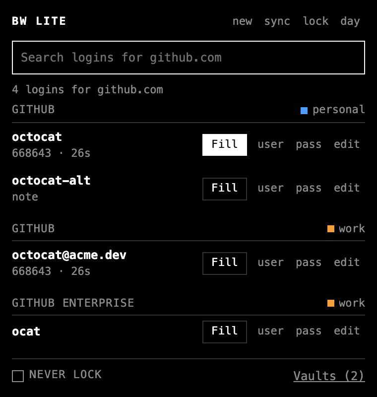
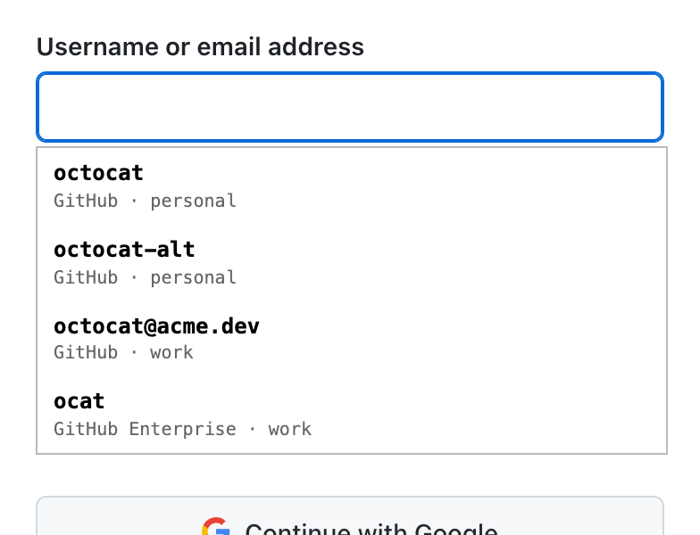

# BW Lite

A tiny Chrome extension for Bitwarden and Vaultwarden. Around 2,000 lines of plain JavaScript, no build step and no framework.

<p>
  
  
</p>

It searches your logins, fills them, shows TOTP codes, saves passkeys and signs in with them, and offers to save or update a login after you sign in. Add as many accounts as you like on bitwarden.com, bitwarden.eu or your own Vaultwarden and they show up as one list with a colored tag for each vault.

Click into a login field and the logins for that site show up right under it. Ctrl+Shift+L (Cmd+Shift+L on a Mac) fills the top one without opening the popup, and the login you used last stays on top. Logins inside iframes get filled too, but only when the frame's own address matches. Matching follows Bitwarden's match setting on each URL and its equivalent domains, so google.com and youtube.com count as one site.

Passkeys are stored the same way Bitwarden stores them, so the official apps can use the ones you make here and the other way round. If you'd rather use your phone or a security key, one button hands the request back to Chrome.

After a submitted login, a small page bar offers a Review save button. Review opens the extension's own confirmation window; the page never hosts the vault or the saved password.

## Install

1. Download `bw-lite-<version>.zip` from [Releases](https://github.com/yowmamasita/bw-lite/releases) and unzip it somewhere permanent
2. Open `chrome://extensions` and turn on Developer mode
3. Click Load unpacked and pick the `bw-lite` folder

The extension ID is always `edggmjogcnhnppgfidekhhdjpdjcpdmk`. Chrome won't install a `.crx` that doesn't come from the Web Store, so there isn't one.

## Security

Your master password never leaves the popup. The vault key and the decrypted list live in Chrome's memory-only session storage and are gone when you lock or quit the browser. Never lock keeps the key on disk instead, exactly like Bitwarden's own Never timeout. Cached vault contents on disk are encrypted; account metadata and login tokens are stored in the browser profile. Nothing gets filled without a click or the shortcut. This code hasn't had an independent security review.

Secure notes, cards and identities aren't supported and stay hidden. Two-step login works with authenticator apps and Bitwarden's emailed new device codes.

## Development

```sh
node test.mjs
docker run -d --name bwlite-vw -p 127.0.0.1:8099:80 -e I_REALLY_WANT_VOLATILE_STORAGE=true \
  -e LOGIN_RATELIMIT_MAX_BURST=100 -e LOGIN_RATELIMIT_SECONDS=1 vaultwarden/server
node test.mjs --integration
./pack.sh
```

`node test.mjs` runs the offline checks; the optional `--integration` checks use the disposable local Vaultwarden above. Not affiliated with Bitwarden, Inc. MIT licensed. `vendor/argon2.umd.min.js` is [hash-wasm](https://github.com/Daninet/hash-wasm), also MIT. `vendor/public_suffix_list.dat` and the generated `vendor/public_suffix_list.js` are the [Public Suffix List](https://publicsuffix.org/list/) from 2026-10-20, licensed under the [Mozilla Public License 2.0](https://mozilla.org/MPL/2.0/); keep both files together when updating the list.
